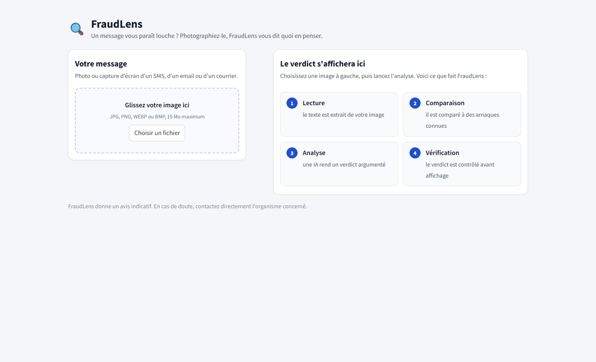
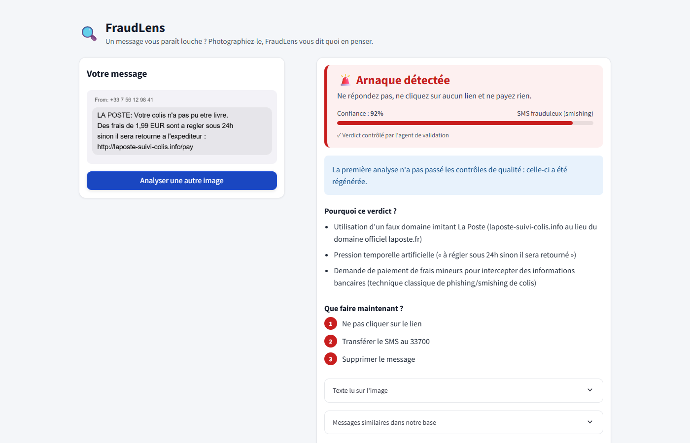

# FraudLens — Multimodal AI Scam Detector


Photograph a suspicious SMS, email, or letter and get a structured verdict: is it a scam, why, and what to do next.

Final project — Advanced Deep Learning, Esprit 2026-2027 (team 5DS).

---

## How It Works

n8n orchestrates four FastAPI agents in sequence:

```
Photo → Streamlit → n8n → /extract → /retrieve → /analyze → /validate → Verdict
                              │            │           │           │
                           Gemini       Qdrant      Gemini      Gemini
                           Vision      (RAG top5)   LLM        guardrails
```

Each agent has one job: extract text from the image, retrieve similar known messages, produce a verdict (`SCAM` / `SUSPICIOUS` / `LEGITIMATE`), then validate it against guardrails and regenerate once if needed.

---

## Tech Stack

| Layer | Technology |
|---|---|
| Orchestration | n8n (self-hosted) |
| Backend | FastAPI 0.111 + Uvicorn |
| AI | Google Gemini `gemini-3.5-flash-lite` + `gemini-embedding-001` |
| Vector store | Qdrant (cosine similarity, 3072-dim vectors) |
| Frontend | Streamlit 1.35 |
| Deployment | Docker Compose (4 services) |

---

## Quick Start

**Prerequisites:** Docker with Compose, Python 3.11+, free [Gemini API key](https://aistudio.google.com/app/apikey).

```bash
# 1. Clone and configure
git clone https://github.com/chaimanaanaa/FraudLens.git
cd FraudLens
cp .env.example .env        # Windows: copy .env.example .env
# → Set GEMINI_API_KEY in .env

# 2. Start services
docker compose up -d --build

# 3. Index the corpus into Qdrant
python -m venv .venv
source .venv/bin/activate   # Windows: .venv\Scripts\activate
pip install -r requirements.txt
python scripts/ingest.py both

# 4. Import the n8n workflow
#    → Open http://localhost:5678, create owner account
#    → Import from file: n8n/fraudlens_workflow.json
#    → Activate the workflow

# 5. Open the app
open http://localhost:8501
```

---

## Gemini API — Limitations & Local Alternatives

> **Note:** The Gemini free tier imposes strict quotas (≈ 15 requests/minute, ≈ 1 500 requests/day per model). One full image analysis consumes 3 requests (extract + analyze + validate). Heavy usage, the evaluation scripts, or concurrent runs will quickly hit these limits and trigger `503 Service Unavailable` or `429 Too Many Requests` errors.
>
> **Privacy consideration:** all images and messages are sent to Google's servers. If the messages being analysed are sensitive (medical, legal, personal), a fully local stack is preferable.

### Running fully offline with local models

Replace the Gemini API calls by running open-source models locally via [Ollama](https://ollama.com). No API key, no quota, no data leaving your machine.

#### Vision / OCR — replace `gemini-3.5-flash-lite`

| Model | Pull command | Notes |
|---|---|---|
| **LLaVA 1.6** | `ollama pull llava:13b` | Strong multimodal, good OCR on screenshots |
| **Qwen2-VL 7B** | `ollama pull qwen2-vl:7b` | Excellent on text-heavy images |
| **Moondream 2** | `ollama pull moondream` | Very lightweight (1.8 B), fast on CPU |
| **MiniCPM-V** | `ollama pull minicpm-v` | Good balance size / accuracy |

#### LLM — replace `gemini-3.5-flash-lite` for analysis and validation

| Model | Pull command | Notes |
|---|---|---|
| **Mistral 7B** | `ollama pull mistral` | Fast, good JSON output |
| **Llama 3.1 8B** | `ollama pull llama3.1` | Strong reasoning, instruction-following |
| **Qwen2.5 7B** | `ollama pull qwen2.5` | Multilingual (French included) |
| **Phi-3 Mini** | `ollama pull phi3:mini` | Very lightweight, runs on CPU |

#### Embeddings — replace `gemini-embedding-001`

| Model | Pull command | Dimension |
|---|---|---|
| **nomic-embed-text** | `ollama pull nomic-embed-text` | 768 |
| **mxbai-embed-large** | `ollama pull mxbai-embed-large` | 1024 |

> ⚠️ If you change the embedding model, update `qdrant.vector_size` in `config/settings.yaml` and re-run `python scripts/ingest.py both` to reindex the corpus with the new dimensions.

---

## Data Sources

The RAG knowledge base and the evaluation set are built from two public datasets downloaded manually:

| Dataset | Source | File location | Size |
|---|---|---|---|
| **UCI SMS Spam Collection** | [archive.ics.uci.edu/dataset/228](https://archive.ics.uci.edu/dataset/228/sms+spam+collection) | `data/raw/smsspamcollection/SMSSpamCollection` | 5 572 SMS (747 spam, 4 825 ham) |
| **Phishing Email Dataset** | [kaggle.com/datasets/naserabdullahalam/phishing-email-dataset](https://www.kaggle.com/datasets/naserabdullahalam/phishing-email-dataset) | `data/raw/archive/Phishing_Email.csv` | 18 634 emails (7 312 phishing, 11 322 safe) |

Both files are excluded from the repository (see `.gitignore`). Place them manually before running `scripts/prepare_data.py`.

---

## Results

Evaluated on 15 test messages (10 spam, 5 legitimate), no overlap with the corpus.

| Metric | Score |
|---|---:|
| Accuracy | 0.933 |
| Precision | 1.000 |
| Recall | 0.900 |
| F1 | 0.947 |
| False positives (legitimate flagged) | 0 / 5 |
| Mean latency (without image extraction) | 14 s |

RAG uses fixed-size chunking (512 tokens, overlap 50) — Hit@5 = 1.0, MRR = 1.0 on the test set.

---

## Project Structure

```
FraudLens/
├── backend/
│   ├── Dockerfile
│   ├── requirements.txt
│   ├── __init__.py
│   ├── main.py                      # FastAPI app — 4 agent routes
│   ├── models.py                    # Pydantic request/response schemas
│   └── agents/
│       ├── __init__.py
│       ├── gemini.py                # Shared Gemini client (retries + model fallback)
│       ├── extract.py               # Vision Agent — image → text
│       ├── retrieve.py              # RAG Agent — text → top-5 passages
│       ├── analyze.py               # Analysis Agent — verdict JSON
│       └── validate.py              # Validator Agent — guardrails + 1 retry
│
├── rag/
│   ├── __init__.py
│   ├── chunking_fixed.py            # Fixed-size token chunking (active strategy)
│   ├── chunking_recursive.py        # Recursive character chunking
│   ├── ingest.py                    # Batched, cached ingestion into Qdrant
│   ├── retriever.py                 # Standalone retriever (used by evaluate.py)
│   └── evaluate.py                  # Hit@5, MRR, Precision@5, Recall@5, FPR
│
├── scripts/
│   ├── prepare_data.py              # Builds corpus/ and test set from data/raw/
│   ├── ingest.py                    # CLI: python scripts/ingest.py [fixed|recursive|both]
│   ├── evaluate_pipeline.py         # End-to-end verdict evaluation on test messages
│   └── compare_prompts.py           # Runs prompts v1 and v2 on the same cases
│
├── prompts/
│   ├── v1/
│   │   ├── extract.txt              # v1 prompt (before)
│   │   ├── analyze.txt              # v1 prompt (before)
│   │   └── validate.txt             # v1 prompt (before)
│   ├── v2/
│   │   ├── extract.txt              # v2 prompt (after — active)
│   │   ├── analyze.txt              # v2 prompt (after — active)
│   │   └── validate.txt             # v2 prompt (after — active)
│   ├── v1_v2_results.json           # Comparison results v1 vs v2
│   ├── prompt_library.md            # Versioned prompt library (exam deliverable)
│   └── CHANGELOG.md                 # Failure log and fixes per prompt
│
├── streamlit/
│   ├── Dockerfile
│   └── app.py                       # Streamlit frontend — upload + verdict display
│
├── n8n/
│   └── fraudlens_workflow.json      # n8n pipeline to import
│
├── config/
│   └── settings.yaml                # RAG params, model names, Qdrant config (no secrets)
│
├── corpus/                          # 50 versioned knowledge-base documents (txt)
│   ├── doc_000_spam_sms.txt … doc_029_spam_email.txt   # 30 spam documents
│   └── doc_030_ham_sms.txt  … doc_049_ham_email.txt    # 20 legitimate documents
│
├── data/                            # ⚠ partially gitignored
│   ├── raw/                         # ✗ gitignored — download manually (see Data Sources)
│   │   ├── smsspamcollection/
│   │   │   ├── SMSSpamCollection    # UCI SMS dataset
│   │   │   └── readme
│   │   └── archive/
│   │       └── Phishing_Email.csv   # Kaggle phishing email dataset
│   └── embeddings_cache.json        # ✗ gitignored — auto-generated by ingest.py (≈ 13 MB)
│
├── doc/                             # README screenshots
│   ├── home.png
│   └── verdict.png
│
├── docs/                            # ✗ gitignored — evaluation result files
│   ├── eval_results_fixed.json
│   ├── eval_results_recursive.json
│   └── pipeline_eval.json
│
├── .env                             # ✗ gitignored — secrets (GEMINI_API_KEY, etc.)
├── .env.example                     # Configuration template
├── .gitignore
├── docker-compose.yml
└── requirements.txt                 # Dependencies for local scripts
```

> Files marked **✗ gitignored** are excluded from the repository and must be generated or downloaded locally.

---

## Demo





*Real run on a synthetic scam SMS. The blue notice shows the Validator rejected the first analysis and the result was regenerated.*
